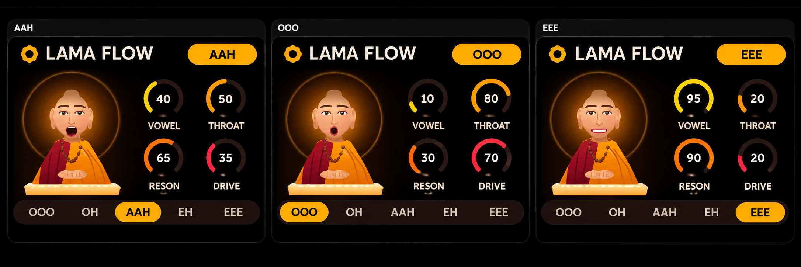

# LAMA FLOW v1.0

### Custom Vocal Synthesizer Firmware for M-VAVE FM-1

**Developed by The King Of Noise — KONStudioPro**

LAMA FLOW is a custom firmware project for the M-VAVE FM-1, featuring a Monk-inspired vocal synthesizer interface, vowel expressions, and sound-shaping controls.

## LAMA FLOW Interface

## Original Monk Character

The Monk character features five vowel expressions:

**OOO • OH • AAH • EH • EEE**

## Firmware Download

**Version:** 1.0

**Device:** M-VAVE FM-1

[Download LAMA FLOW v1.0](https://github.com/KONStudioPro/LAMA-FLOW/releases/tag/v1.0)

Download the `.fwsc` firmware file from the release assets.

## Installation

This firmware is intended for the M-VAVE FM-1. Verify device compatibility and back up your existing firmware and settings before installing. Follow the appropriate firmware installation procedure.

## Developer

**The King Of Noise**

GitHub: [KONStudioPro](https://github.com/KONStudioPro)

---

LAMA FLOW — Custom Firmware Project © 2026 The King Of Noise.
